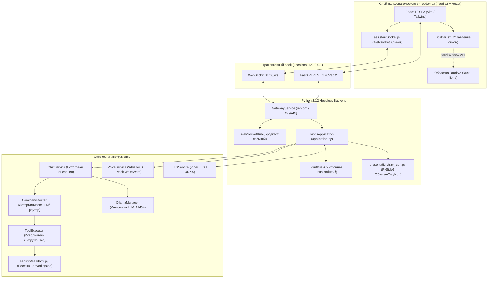
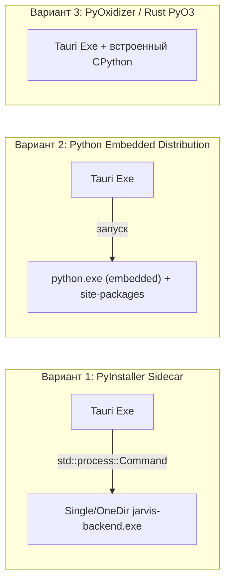
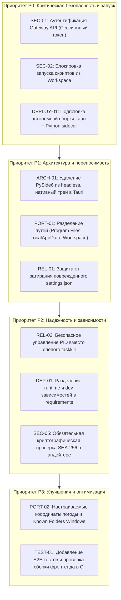

# Комплексный технический аудит: Portability, Deployment, Security & Architecture
**Проект:** JARVIS (Kirieshka v2)  
**Ветка:** `osnova`  
**Дата:** Ноябрь 2026 г.  
**Статус:** Выполнен этап аудита (без изменения программного кода)  

---

## A. Executive Summary

Настоящий аудит представляет собой всестороннее исследование кодовой базы JARVIS (Kirieshka v2) на рабочей ветке `osnova`. Цель аудита - установить, насколько текущая архитектура готова к автономному, воспроизводимому и безопасному развертыванию на произвольной чистой машине с Windows 10/11 x64 без привязки к машине разработчика.

### Ключевые выводы
1. **Приложение сейчас не является распространяемым дистрибутивом.** Проект запускается исключительно как среда разработки: запуск через `start.bat` выполняет `npx.cmd tauri dev`, что требует наличия компилятора Rust (1.85+), MSVC C++ Build Tools с Windows SDK, Node.js (20+) и виртуального окружения Python. Сборка бинарного пакета (`tauri build`) не завершена архитектурно: у Tauri v2 нет конфигурации sidecar/externalBin для Python, а Python-бэкенд не упакован в standalone-рантайм.
2. **Локальный REST API FastAPI и WebSocket не имеют авторизации.** Порт `8765` слушает на `127.0.0.1` без API-ключей, сессионных токенов или защиты от межсайтовых запросов (CSRF). Любой локальный процесс или вредоносная веб-страница в браузере пользователя может отправлять запросы на перезапись настроек (`/api/settings`), запуск приложений (`/api/apps/launch`), перехват Telegram-бота или аварийное выключение ПК.
3. **Архитектурная связь с PySide6 не разорвана.** Несмотря на переход на современный UI на базе Tauri v2 + React, Python-бэкенд в режиме `--headless` по-прежнему создает экземпляр `QApplication` из PySide6 ради системного трея (`presentation/tray_icon.py`). Это удерживает тяжелейшую зависимость (~350 МБ на диске) и блокирует переход на легкий нативный трей.
4. **Нарушения переносимости файловой системы.** Запись логов (`LOG_DIR = APP_ROOT / "logs"`) и рабочего каталога (`WORKSPACE_DIR = APP_ROOT / "workspace"`) привязана к корневому каталогу установки. При установке в `C:\Program Files\` это вызовет `PermissionError`. В то же время гигабайты бинарных моделей (Piper TTS ONNX, Vosk, Whisper) сохраняются в перемещаемый профиль `%APPDATA%` (Roaming) вместо `%LOCALAPPDATA%`.
5. **Тестовая база.** Набор тестов содержит 673 проходящих теста, демонстрируя хорошую внутреннюю дисциплину бэкенда. Однако тестирование сфокусировано исключительно на изоляции модулей с помощью моков: отсутствуют сквозные (E2E) тесты запуска, тесты компиляции React-фронтенда и сборки Rust-оболочки, а также тесты установки на чистом Windows runner.

---

## B. Current Architecture

Фактическое взаимодействие компонентов на ветке `osnova`:



### Реальный путь данных и нестыковки
1. Запуск инициируется `start.bat`. Он запускает `pythonw start/bootstrap.py --headless`, ждет готовности через `start/splash.py` (PySide6), затем в скрытом окне PowerShell вызывает `npx.cmd tauri dev`.
2. `tauri dev` компилирует Rust-код и поднимает Vite dev-сервер на порту `5174`. Rust-оболочка (`ui/src-tauri/src/lib.rs`) не имеет логики запуска Python-процесса.
3. React-приложение подключается к `ws://127.0.0.1:8765/ws` и дергает REST API `http://127.0.0.1:8765/api/...`.
4. Системный трей Windows управляется не Rust-оболочкой, а Python-процессом через `PySide6.QtWidgets.QSystemTrayIcon`. Если пользователь скрывает окно в React (`win.hide()`), восстановить его кликом из трея Python пытается через `ctypes.windll.user32.ShowWindow` или заново запуская `npx.cmd tauri dev` через PowerShell.

---

## C. Runtime & Deployment Audit

### 1. Требования к окружению: Разработка против Эксплуатации
| Компонент | Требуется для разработки | Требуется для конечного пользователя (сейчас) | Должно требоваться конечному пользователю |
| :--- | :--- | :--- | :--- |
| **Python Runtime** | 3.12 (64-bit) | 3.12 в `PATH` или ручной `.venv` | Встроенный portable Python (embedded) |
| **Node.js & npm** | 20+ LTS | Обязательно (из-за `tauri dev` в `start.bat`) | Не требуется (фронтенд компилируется в assets) |
| **Rust & Cargo** | 1.85+ stable | Обязательно (Rust компилируется при старте) | Не требуется (Tauri компилируется в `.exe`) |
| **MSVC Build Tools** | VS 2022 C++ + WinSDK | Обязательно (иначе Cargo падает) | Не требуется |
| **WebView2** | Microsoft Edge WebView2 | Microsoft Edge WebView2 | Входит в состав Windows 10/11 |
| **Ollama** | Локальный сервис LLM | Локальный сервис LLM | Опционально / автозагрузка |
| **PySide6** | Архивный GUI и тесты | Обязательно (нужен для `tray_icon.py`!) | Не требуется вовсе |

### 2. Сравнение архитектур поставки Python-бэкенда с Tauri
Для превращения проекта в автономный продукт рассмотрены следующие варианты:



| Критерий | Вариант 1: PyInstaller Sidecar (OneDir) | Вариант 2: Python 3.12 Embedded Zip | Вариант 3: PyOxidizer / PyO3 |
| :--- | :--- | :--- | :--- |
| **Сложность внедрения** | Низкая (стандартный для Tauri sidecar) | Средняя (требует подготовки скрипта сборки колес) | Экстремально высокая (конфликты с C-расширениями pywin32, sounddevice) |
| **Совместимость с C-библиотеками** | Высокая (faster-whisper, onnxruntime, vosk, pywin32) | Высокая (распаковка предсобранных wheel) | Низкая (многие C-библиотеки не линкуются статически) |
| **Размер пакета** | ~250-400 МБ | ~200-350 МБ | ~200-300 МБ |
| **Время холодного старта** | 1.0 - 2.5 сек (OneDir) | 0.8 - 1.5 сек | < 0.5 сек |
| **Изоляция и переносимость** | Полная (не зависит от системного Python) | Полная (полностью portable) | Полная |
| **Вердикт** | **Рекомендуется как основной вариант** | Допустимая альтернатива | Не рекомендуется |

---

## D. Portability Audit

### Выявленные проблемы переносимости путей и профилей
1. **Жесткая привязка LOG_DIR к корню проекта:**
   В `core/app_paths.py`:
   ```python
   LOG_DIR = APP_ROOT / "logs"
   ```
   Если приложение установлено в `C:\Program Files\Jarvis`, попытка записи логов завершится с ошибкой прав доступа `PermissionError`. Логи обязаны размещаться в `%LOCALAPPDATA%\Jarvis\logs`.
2. **Размещение рабочего каталога Workspace в каталоге программы:**
   ```python
   WORKSPACE_DIR = APP_ROOT / "workspace"
   ```
   Каталог `workspace/` предназначен для чтения и записи пользовательских файлов инструментами ассистента. В защищенных каталогах Windows запись туда невозможна без прав администратора.
3. **Хранение тяжелых бинарных моделей в Roaming Profile:**
   `core/app_paths.py` определяет `APP_DATA_DIR = Path(os.environ.get("APPDATA")) / "Jarvis"`. В этот каталог сохраняются:
   - Модели Vosk (`APP_DATA_DIR / "wake_word" / ...`)
   - Модели Piper TTS (`APP_DATA_DIR / "tts" / "voices" / ...`)
   - Модели Whisper (`APP_DATA_DIR / "models" / ...`)
   - Сборка Zapret (`APP_DATA_DIR / "zapret"`)
   - Аудиокэш (`APP_DATA_DIR / "tts" / "assets"`)
   Каталог `%APPDATA%` (Roaming) в корпоративных и сетевых доменах синхронизируется по сети при входе и выходе пользователя. Размещение там гигабайтных моделей замедляет синхронизацию профиля и нарушает спецификацию Microsoft Windows.
4. **Определение системных папок пользователя без учета перенаправления:**
   В `tools/system_actions.py` системные папки разрешаются через `Path.home() / "Downloads"`, `Path.home() / "Desktop"`. Если пользователь переместил рабочий стол на диск `D:` или использует синхронизацию OneDrive, функция создает пустые каталоги на диске `C:` вместо открытия реальных пользовательских папок.

---

## E. Security Audit

### 1. Application & API Security: Полное отсутствие аутентификации в REST и WebSocket
- **Файл:** `services/gateway/deps.py`, `services/gateway_service.py`, `services/gateway/routers/*`
- **Уязвимость:** Сервис FastAPI запускается на `127.0.0.1:8765`. В документации заявлено наличие сессионных токенов в `deps.py`, однако фактически функция `get_gateway` просто возвращает объект шлюза:
  ```python
  def get_gateway(request: Request) -> Any:
      return request.app.state.gateway
  ```
- **Механизм атаки:** Использование `127.0.0.1` не изолирует API от атак из браузера пользователя. Межсайтовые запросы (Simple Requests в стандарте CORS) отправляются браузером без preflight OPTIONS запроса. Любой сайт, открытый пользователем в Chrome/Firefox/Edge, может отправить форму или POST-запрос на `http://127.0.0.1:8765/api/commands/execute`, `/api/apps/launch`, `/api/shutdown` или `/api/settings`.
- **Последствия:** Злоумышленник может перезаписать `settings.json`, передав свой `allowed_chat_ids` для Telegram-бота, активировать `allow_outside_workspace=True` и получить удаленный доступ к компьютеру.

### 2. Выполнение произвольного кода через Workspace и launch_application
- **Файл:** `tools/applications.py`, `tools/files.py`
- **Уязвимость:** Функция `launch_application(target)` сначала ищет совпадение в каталоге Workspace через `resolve_tool_path(target)`. Если файл найден внутри `workspace/`, он запускается напрямую через `os.startfile(file_path)` без проверки расширения:
  ```python
  file_path, matches = resolve_tool_path(target)
  if file_path is not None:
      return _start_path(file_path)
  ```
- **Механизм атаки:** Инструмент `write_file` позволяет создать в `workspace/` файл с любым расширением (например, `update.bat`, `script.vbs`, `payload.cmd`). Затем вызов `launch_application("update.bat")` выполняет этот скрипт в Windows. Ограничение «файловые операции заперты в Workspace» полностью нивелируется возможностью выполнения исполняемых файлов из Workspace.

### 3. Автоматический поиск и неконтролируемое выполнение bat-файлов Запрета
- **Файл:** `core/vpn/zapret_controller.py`
- **Уязвимость:** Функция `find_zapret_archive()` ищет по всем доступным дискам любые zip-архивы, содержащие файл `service.bat`. При вызове распаковки `extract_zapret()` архив распаковывается в `APP_DATA_DIR / "zapret"`, после чего `launch_service_bat()` вызывает `os.startfile(service_bat)`.
- **Риск:** Если в загрузках или временных папках пользователя лежит сторонний или вредоносный архив с `service.bat`, вызов API `/api/vpn/zapret` распакует и запустит его от имени пользователя.

### 4. Небезопасная распаковка архивов (Zip Slip в Wake Word)
- **Файл:** `voice/wake_word.py`
- **Уязвимость:** Функция `_download_model` загружает zip-архив модели Vosk с `alphacephei.com` и распаковывает его вызовом `archive_file.extractall(model_dir.parent)` без валидации относительных путей членов архива (Zip Slip). В отличие от `services/update_validator.py`, где валидация реализована отлично, здесь используется стандартный небезопасный метод.
- **Хранение секретов:** Telegram Bot Token хранится в открытом виде в `%APPDATA%\Jarvis\settings.json`.

### 5. Обновления и криптографическая проверка
- **Файл:** `services/update_downloader.py`, `services/update_validator.py`
- **Уязвимость:** Архивы обновлений проверяются на размер и структуру ZIP, но криптографическая проверка контрольной суммы SHA-256 выполняется условно:
  ```python
  if plan.sha256_digest and digest.hexdigest().casefold() != plan.sha256_digest.casefold():
  ```
  Если в манифесте релиза на GitHub поле `sha256_digest` отсутствует (`None`), проверка хэша пропускается. Подпись Ed25519 / GPG / minisign не проверяется вовсе.

---

## F. Architecture Audit

### 1. Архитектурный разрыв между Tauri UI и Python Backend
- **Проблема:** Tauri v2 позиционируется как основной интерфейс, однако приложение спроектировано как два независимых процесса без родительского контроля.
- **Следствия:**
  - `start.bat` убивает процессы по номерам портов (`taskkill /f /pid %%a`) через `netstat`, что является опасным костылем: если порт 8765 или 5174 занят посторонней программой, она будет принудительно завершена.
  - При закрытии окна Tauri окно React уничтожается или скрывается, но если процесс Python аварийно завершится, Tauri UI останется висеть с бесконечным реконнектом.
  - При закрытии приложения через системный трей Python вызывает `os._exit(0)`, оставляя окно Tauri работать в фоне.

### 2. Избыточная привязка бэкенда к PySide6
- **Проблема:** Точка входа headless-бэкенда `start/main.py` содержит безусловный импорт PySide6:
  ```python
  from PySide6.QtWidgets import QApplication
  app = QApplication(sys.argv)
  ```
- **Причина:** Единственное использование PySide6 в фоновом режиме - создание системного трея `QSystemTrayIcon` в `presentation/tray_icon.py`.
- **Решение:** В Tauri v2 системный трей нативно поддерживается на уровне Rust (`tauri::tray::TrayIconBuilder`). Трей должен быть реализован в Rust, что позволит полностью удалить PySide6 из зависимостей headless-сервера.

### 3. Дублирование логики и смешение зон ответственности
- `services/stark_protocols.py` содержит более 590 строк монолитного кода, объединяющего закрытие процессов, системные вызовы Windows, проверку погоды в Москве через Open-Meteo, резолв приложений и генерацию текстов.
- `services/command_router.py` и его диспетчеры в `services/router/` частично дублируют логику проверки запущенных процессов и резолва имен, присутствующую в `tools/applications.py` и `core/app_indexer.py`.

---

## G. Dependencies & Supply Chain Audit

### 1. Анализ `config/requirements.txt`
```text
PySide6>=6.8,<7         # 150+ MB колесо, не нужно для Tauri UI
requests>=2.32,<3       # Используется параллельно с httpx (дублирование HTTP-клиентов)
psutil                  # Runtime
pywin32                 # Runtime Windows
pymorphy3>=2.0,<3       # Runtime (стемминг)
pytest>=8,<9            # ОШИБКА: dev-зависимость в проде!
pytest-cov>=5,<8        # ОШИБКА: dev-зависимость в проде!
numpy>=1.26,<3          # Runtime (аудио буферы)
sounddevice>=0.5,<1     # Runtime
faster-whisper>=1.2,<2  # Runtime STT (тянет ctranslate2, onnxruntime)
vosk>=0.3.45,<0.4       # Runtime WakeWord
srt>=3.5,<4             # Утилита субтитров
websockets>=10,<16      # Runtime
fastapi>=0.110.0        # Runtime Gateway
uvicorn>=0.28.0         # Runtime Server
piper-tts>=1.8,<2       # Runtime TTS
rapidfuzz>=3.0.0,<4     # Runtime fuzzy match
uiautomation>=2.0,<3    # Runtime UI automation
httpx>=0.27,<1          # Runtime HTTP/async
pillow>=10.0,<14        # Runtime скриншоты
packaging>=23.0         # Runtime версионирование
tqdm>=4.66              # Progress bar
huggingface_hub>=0.20   # Загрузка моделей
```

### Замечания по зависимостям
1. **Тестовые пакеты в проде:** `pytest` и `pytest-cov` находятся в основном `requirements.txt`. При установке конечный пользователь вынужден выкачивать компиляторы и тестовые библиотеки.
2. **Дублирование библиотек:** В проекте одновременно установлены `requests` и `httpx`. `requests` используется синхронно в `ollama_manager`, `update_downloader`, а `httpx` - в `telegram_bot`, `network_checker`.
3. **Отсутствие lock-файла для Python:** Версии указаны диапазонами (`>=1.2,<2`), что может привести к установке ломающего минорного релиза на чистой машине в будущем.

---

## H. Testing & Quality Assurance Audit

1. **Текущий статус тестовой базы:**
   - 673 теста выполняются успешно за 72 секунды.
   - 3 теста пропущены (`skipped`).
   - 2 предупреждения о deprecation (`StarletteDeprecationWarning`, `DeprecationWarning: presentation.legacy`).
2. **Пробелы в тестовом покрытии:**
   - **Frontend (React):** 0 тестов. Отсутствуют Vitest / Jest / React Testing Library. Сборка React-компонентов не проверяется в CI.
   - **Desktop Shell (Tauri Rust):** 0 тестов `cargo test`. В CI отсутствует шаг проверки синтаксиса Rust (`cargo check`).
   - **Установка и чистый запуск:** В GitHub Actions (`tests.yml`) тестируется только Python под управлением готового runner. Сценарий развертывания через `start.bat` или инсталлятор не тестируется.
   - **Чрезмерный мокинг:** Тесты интеграций со Steam, VPN и аудиосистемой полностью замоканы и не верифицируют реальное поведение Windows API.

---

## I. Reliability & Resilience Audit

1. **Аварийное завершение процесса и занятые порты:**
   Если бэкенд упал, порт 8765 может оставаться в состоянии `TIME_WAIT` или удерживаться зависшим субпроцессом. Скрипт `start.bat` решает это грубым убийством любого процесса, слушающего порт 8765, через `taskkill /f /pid`, что создает риск убийства системных или пользовательских программ.
2. **Повреждение конфигурации при сбое питания:**
   В `core/config_manager.py` при синтаксической ошибке в `settings.json` метод `_load` возвращает пустой словарь `data = {}`, который затем сливается с дефолтным конфигом и перезаписывает файл на диске:
   ```python
   try:
       data = json.loads(source.read_text(encoding="utf-8")) if source.exists() else {}
   except (OSError, json.JSONDecodeError):
       data = {}
   ```
   Пользователь теряет все свои токены, алиасы и настройки без создания аварийной резервной копии (`settings.json.corrupted`).
3. **Работа в офлайн-режиме:**
   При первом запуске без интернета приложение полностью неработоспособно: `install_dependencies.bat` завершается аварийно с кодом 1, модели Vosk и Piper не могут быть загружены, а запросы к Ollama завершаются таймаутами. Сообщения об ошибках для пользователя не содержат четких инструкций по автономной установке.

---

## J. Моделирование сценариев развертывания на чистой машине (Clean Machine Testing)

Ниже представлена детальная матрица поведения системы при моделировании запуска на чистой Windows 10/11 x64 (15 сценариев):

| № | Сценарий | Ожидаемое поведение | Фактическое поведение | Авто-восстановление | Понятность ошибки |
|---|---|---|---|:---:|---|
| 1 | Нет виртуального окружения `.venv` | Скрипт тихо создает `.venv` и ставит зависимости | `start.bat` вызывает `install_dependencies.bat`, создает `.venv --system-site-packages` | Частично | Средняя (требует интернет) |
| 2 | Нет установленных библиотек Python | Установка из локального кэша колес | Запуск `pip install -r requirements.txt` из сети. При отсутствии интернета падает с ошибкой | Нет | Низкая (простыня логов pip) |
| 3 | Отсутствует Node.js / npm | Запуск готового предсобранного приложения | Падение проверки `where npx`. Скрипт пытается откатиться на PySide6 (`run_legacy`) | Нет | Сообщение в консоли CMD |
| 4 | Отсутствует Rust / Cargo | Запуск готового предсобранного приложения | Падение проверки `where cargo`. Скрипт пытается откатиться на PySide6 (`run_legacy`) | Нет | Сообщение в консоли CMD |
| 5 | Отсутствует MSVC C++ Build Tools | Работа приложения без компиляции | При первом запуске `tauri dev` падает линкер `link.exe not found`. Приложение не стартует | Нет | Криптичная ошибка Rust линкера |
| 6 | Нет пользовательских конфигураций | Создание дефолтных настроек в AppData | Создается `%APPDATA%\Jarvis\settings.json` со стандартными значениями | Да | Понятно (штатное поведение) |
| 7 | Нет скачанных моделей Whisper и Piper | Фоновая загрузка по требованию с индикацией | Whisper пытается скачать с HF; Piper выдает ошибку голоса; Vosk блокирует поток скачиванием zip | Частично | Ошибки в логах, в UI отображается статус |
| 8 | Ollama не установлена / не запущена | Предупреждение в UI, работа текстового роутера | `OllamaManager.start()` пытается выполнить `ollama serve`. Падает `FileNotFoundError` | Нет | В чате отображается ошибка подключения к LLM |
| 9 | Полностью отсутствует интернет | Работа локальных модулей, понятные подсказки | Скрипт установки падает; загрузка моделей падает; опрос погоды в протоколе "Утро" игнорируется | Нет | Батник висит на `pause` с ошибкой pip |
| 10 | Запуск из нестандартной папки | Корректный расчет корня приложения | `APP_ROOT` рассчитывается корректно через `Path(__file__).resolve().parents[1]` | Да | Штатное поведение |
| 11 | Путь содержит пробелы и кириллицу | Корректное экранирование во всех вызовах | В `start.bat` и `tray_icon.py` пути обернуты в кавычки, однако скрипты PowerShell иногда сбоят | Частично | Сбои в PowerShell аргументах |
| 12 | Пользователь без прав Администратора | Запуск из AppData/Local, запись логов в Local | Если папка лежит в `Program Files`, падает при попытке создания `logs/` и `workspace/` | Нет | `PermissionError` без пояснения |
| 13 | Порт 8765 или 5174 занят | Корректный выбор свободного порта | `start.bat` принудительно убивает любой чужой процесс на этом порту через `taskkill /f`! | Опасно | Приводит к завершению чужих программ |
| 14 | Аварийный сбой предыдущего процесса | Очистка lock-файлов, корректный подъем | Убивает старый PID по порту, логи перетираются (`_clear_previous_logs`) | Да | Логи старой аварии стираются! |
| 15 | Установка была прервана на середине | Восстановление битых файлов пакетов | `.venv` остается в сломанном состоянии; `check_dependencies.py` падает, требуется `--repair` | Нет | Требует ручного запуска с флагом |

---

## K. Реестр выявленных дефектов и уязвимостей

### Дефект SEC-01: Отсутствие аутентификации и CSRF-защиты в Gateway API
- **Приоритет:** P0 (Критический)
- **Затронутые файлы:** `services/gateway_service.py`, `services/gateway/deps.py`, `services/gateway/routers/*`
- **Участок кода:**
  ```python
  # services/gateway/deps.py
  def get_gateway(request: Request) -> Any:
      return request.app.state.gateway
  ```
- **Суть проблемы:** Любая программа на компьютере и любой сайт в браузере пользователя могут беспрепятственно вызывать команды ассистента.
- **Техническое объяснение:** FastAPI-роутеры не требуют API-ключа или bearer-токена. Запросы не проверяют заголовок `Origin` для простых HTTP-методов (POST формы). В браузере возможен межсайтовый запрос (CSRF), запускающий системные команды или меняющий настройки Jarvis.
- **Возможные последствия:** Несанкционированное удаленное управление компьютером, перезапись настроек безопасности, кража конфиденциальных данных.
- **Способ воспроизведения:**
  Выполнить из терминала или через стороннюю HTML-страницу:
  ```bash
  curl -X POST http://127.0.0.1:8765/api/commands/execute -H "Content-Type: application/json" -d "{\"command\":\"заблокируй пк\"}"
  ```
  Экран будет заблокирован без каких-либо проверок прав.
- **Предлагаемое решение:** Генерировать локальный криптографический сессионный токен при старте бэкенда, сохранять его во временный файл в защищенной директории пользователя или передавать через аргументы в Tauri, и проверять `Authorization: Bearer <token>` во всех роутерах FastAPI и при WebSocket hand-shake.
- **Необходимые регрессионные тесты:** `tests/test_gateway_security.py` с проверкой возврата кодов `401 Unauthorized` и `403 Forbidden` при отсутствии или неверном токене.
- **Побочные эффекты исправления:** Потребуется передача токена в React UI при инициализации соединения.

---

### Дефект SEC-02: Выполнение произвольных исполняемых файлов из Workspace
- **Приоритет:** P0 (Критический)
- **Затронутые файлы:** `tools/applications.py`, `tools/files.py`
- **Участок кода:**
  ```python
  # tools/applications.py (строки 510-517)
  file_path, matches = resolve_tool_path(target)
  if file_path is not None:
      return _start_path(file_path)
  ```
- **Суть проблемы:** Создание bat/cmd/vbs/exe внутри песочницы позволяет обойти запрет на запуск внешних приложений.
- **Техническое объяснение:** Песочница `security/sandbox.py` защищает файловые операции чтения и записи границами `workspace/`. Однако инструмент `launch_application` считает запуск любого объекта из `workspace/` безопасным по умолчанию и передает его в `os.startfile()`.
- **Возможные последствия:** Удаленное или модельное выполнение произвольного кода (RCE). Модель может записать скрипт через `write_file` и запустить его.
- **Способ воспроизведения:** Вызвать `write_file("hack.bat", "calc.exe")`, затем `launch_application("hack.bat")`.
- **Предлагаемое решение:** Запретить запуск исполняемых расширений (`.exe`, `.bat`, `.cmd`, `.vbs`, `.ps1`, `.js`, `.scr`, `.com`) из каталога Workspace через `launch_application`, либо требовать явное подтверждение пользователя с предупреждением об исполняемом файле.
- **Необходимые регрессионные тесты:** `test_launch_application_blocks_executable_scripts_in_workspace`.
- **Побочные эффекты исправления:** Пользователи не смогут запускать свои батники из папки Workspace без явного разрешения.

---

### Дефект DEPLOY-01: Отсутствие сборки Tauri и зависимость запуска от среды разработки
- **Приоритет:** P0 (Критический)
- **Затронутые файлы:** `start.bat`, `ui/src-tauri/tauri.conf.json`, `ui/src-tauri/src/lib.rs`
- **Участок кода:**
  ```bat
  # start.bat
  powershell -WindowStyle Hidden -Command "Start-Process cmd -ArgumentList '/c npx.cmd tauri dev' ..."
  ```
- **Суть проблемы:** Приложение нельзя запустить на компьютере без установленных инструментов разработчика (Rust, Cargo, MSVC, Node.js).
- **Техническое объяснение:** `start.bat` запускает dev-сервер Tauri (`tauri dev`). Конфигурация `tauri.conf.json` не содержит настройки `bundle.externalBin` для Python-sidecar, а Rust-код `lib.rs` является шаблонным и не управляет жизненным циклом бэкенда.
- **Возможные последствия:** Невозможность распространять приложение среди пользователей, не являющихся разработчиками.
- **Способ воспроизведения:** Запустить `start.bat` на чистой виртуальной машине Windows без Rust и Node.js.
- **Предлагаемое решение:**
  1. Настроить сборку продакшн-бандла (`tauri build`).
  2. Упаковать Python-бэкенд через PyInstaller в каталог `sidecar/`.
  3. В `lib.rs` реализовать запуск и остановку sidecar-процесса бэкенда через Tauri command API.
- **Необходимые регрессионные тесты:** CI-тест сборки бинарного пакета и проверка запуска на чистом Windows Runner.
- **Побочные эффекты исправления:** Увеличение времени сборки в CI.

---

### Дефект ARCH-01: Жесткая зависимость headless-бэкенда от PySide6 ради системного трея
- **Приоритет:** P1 (Высокий)
- **Затронутые файлы:** `start/main.py`, `presentation/tray_icon.py`, `config/requirements.txt`
- **Участок кода:**
  ```python
  # start/main.py
  from PySide6.QtWidgets import QApplication
  app = QApplication(sys.argv)
  ...
  tray = create_system_tray(app, backend)
  ```
- **Суть проблемы:** Фоновый сервер требует огромную библиотеку PySide6 только для того, чтобы показывать иконку в трее.
- **Техническое объяснение:** PySide6 весит более 350 МБ и требует инициализации Qt event loop. При этом основной интерфейс уже переведен на Tauri v2.
- **Возможные последствия:** Медленный запуск, повышенное потребление оперативной памяти, раздутый размер дистрибутива, конфликт циклов событий.
- **Способ воспроизведения:** Проверить список процессов: `pythonw.exe` держит загруженные Qt DLL даже при работе с Tauri UI.
- **Предлагаемое решение:** Перенести системный трей в Rust (штатный функционал Tauri v2), а из Python-бэкенда полностью удалить зависимость от PySide6 для headless-режима.
- **Необходимые регрессионные тесты:** Тесты запуска бэкенда в чистом headless-режиме без импорта PySide6.
- **Побочные эффекты исправления:** Старый интерфейс `ui_archive` станет полностью изолированным и не будет требоваться для базовой работы.

---

### Дефект PORT-01: Размещение логов и Workspace в каталоге установки приложения
- **Приоритет:** P1 (Высокий)
- **Затронутые файлы:** `core/app_paths.py`, `core/logging_config.py`, `security/sandbox.py`
- **Участок кода:**
  ```python
  WORKSPACE_DIR = APP_ROOT / "workspace"
  LOG_DIR = APP_ROOT / "logs"
  ```
- **Суть проблемы:** Приложение падает при установке в стандартную папку `Program Files`.
- **Техническое объяснение:** Каталоги `Program Files` защищены UAC и правами доступа NTFS. Попытка создания файлов логов и папок Workspace обычным пользователем вызывает `PermissionError`.
- **Возможные последствия:** Невозможность стандартной установки в систему.
- **Способ воспроизведения:** Установить права Read-Only на директорию проекта и вызвать `start.bat`.
- **Предлагаемое решение:** Разделить пути на три уровня:
  - Ресурсы приложения (read-only): `RESOURCE_ROOT` (`APP_ROOT`).
  - Данные пользователя (read-write): `%APPDATA%\Jarvis` (настройки, алиасы, профили).
  - Временные данные, кэш и логи (read-write): `%LOCALAPPDATA%\Jarvis` (логи, модели, кэш аудио).
  - Workspace по умолчанию размещать в пользовательском каталоге: `%USERPROFILE%\Documents\JarvisWorkspace` (с возможностью переопределения в настройках).
- **Необходимые регрессионные тесты:** `tests/test_start_and_paths_layers.py` с проверкой путей без прав записи в `APP_ROOT`.
- **Побочные эффекты исправления:** Потребуется миграция существующих данных пользователя.

---

### Дефект REL-01: Аварийное уничтожение конфигурации при ошибке чтения settings.json
- **Приоритет:** P1 (Высокий)
- **Затронутые файлы:** `core/config_manager.py`
- **Участок кода:**
  ```python
  try:
      data = json.loads(source.read_text(encoding="utf-8")) if source.exists() else {}
  except (OSError, json.JSONDecodeError):
      data = {}
  ```
- **Суть проблемы:** Если файл настроек повредился (например, при внезапном отключении питания), программа затирает его дефолтными настройками.
- **Техническое объяснение:** Метод `_load` перехватывает `JSONDecodeError` и подставляет пустой словарь `{}`, который тут же сохраняется поверх поврежденного файла. Все токены Telegram, выбранные модели и настройки пользователя безвозвратно теряются.
- **Возможные последствия:** Потеря пользовательских настроек и секретов.
- **Способ воспроизведения:** Записать в `settings.json` некорректный JSON (например `{ "broken": `) и перезапустить бэкенд.
- **Предлагаемое решение:** При обнаружении ошибки парсинга немедленно сохранять поврежденный файл с суффиксом `.corrupted_<timestamp>` и логировать предупреждение, прежде чем загружать дефолты.
- **Необходимые регрессионные тесты:** `tests/test_config_manager_preserves_corrupted_file`.
- **Побочные эффекты исправления:** Нет.

---

### Дефект REL-02: Грубое завершение процессов по номерам портов в start.bat
- **Приоритет:** P2 (Средний)
- **Затронутые файлы:** `start.bat`
- **Участок кода:**
  ```bat
  for /f "tokens=5" %%a in ('netstat -aon ^| findstr :8765 ^| findstr LISTENING') do (
      taskkill /f /pid %%a >nul 2>&1
  )
  ```
- **Суть проблемы:** Скрипт запуска без предупреждения убивает сторонние программы, если они заняли порт 8765 или 5174.
- **Техническое объяснение:** Команда `taskkill /f /pid` завершает процесс без проверки его имени (`python.exe`, `node.exe` и т.д.).
- **Возможные последствия:** Потеря данных в посторонних приложениях пользователя.
- **Способ воспроизведения:** Запустить стороннюю утилиту на порту 8765 и запустить `start.bat`.
- **Предлагаемое решение:** Проверять имя процесса перед завершением или записывать PID бэкенда в `.pid`-файл в `%LOCALAPPDATA%\Jarvis` и завершать только свой собственный процесс.
- **Необходимые регрессионные тесты:** Тестирование скрипта запуска на занятых портах.
- **Побочные эффекты исправления:** Потребуется корректная очистка PID-файлов.

---

### Дефект DEP-01: Тестовые библиотеки в производственных зависимостях
- **Приоритет:** P2 (Средний)
- **Затронутые файлы:** `config/requirements.txt`
- **Участок кода:**
  ```text
  pytest>=8,<9
  pytest-cov>=5,<8
  ```
- **Суть проблемы:** Пользователи скачивают тестовые утилиты при обычной установке.
- **Техническое объяснение:** Отсутствует разделение зависимостей на `requirements.txt` (runtime) и `requirements-dev.txt` (тесты и разработка).
- **Возможные последствия:** Увеличение времени установки и размера окружения на 50+ МБ.
- **Предлагаемое решение:** Вынести `pytest` и `pytest-cov` в отдельный `requirements-dev.txt`.
- **Необходимые регрессионные тесты:** Проверка успешности установки `requirements.txt` без тестовых пакетов.
- **Побочные эффекты исправления:** Обновление шагов CI в `tests.yml`.

---

### Дефект PORT-02: Жестко зашитые координаты погоды и окружения в протоколах
- **Приоритет:** P3 (Низкий)
- **Затронутые файлы:** `services/stark_protocols.py`
- **Участок кода:**
  ```python
  url = "https://api.open-meteo.com/v1/forecast?latitude=55.7558&longitude=37.6173&current_weather=true"
  ...
  return f", в Москве сейчас {round(temp)}°"
  ```
- **Суть проблемы:** Протокол "Доброе утро" всегда сообщает погоду в Москве, независимо от места нахождения пользователя.
- **Техническое объяснение:** Координаты и город жестко зашиты в коде метода `get_weather_info`.
- **Возможные последствия:** Недостоверная информация для пользователей из других городов.
- **Предлагаемое решение:** Вынести город и координаты в `settings.json` с возможностью настройки через UI.
- **Необходимые регрессионные тесты:** Тест генерации брифинга с кастомными координатами.
- **Побочные эффекты исправления:** Нет.

---

## L. Technical Glossary

Для прозрачности и единообразия технической терминологии в проекте составлен глоссарий:

- **Sidecar-процесс (Sidecar Process):** Архитектурный паттерн, при котором вспомогательное приложение (в нашем случае Python FastAPI бэкенд) запускается рядом с основным нативным процессом (Tauri Rust) и управляется его жизненным циклом (запуск, мониторинг, корректное завершение).
- **CORS (Cross-Origin Resource Sharing):** Механизм браузерной безопасности, определяющий, каким веб-ресурсам разрешено читать ответы на кросс-доменные запросы. *Важно:* CORS защищает чтение ответа в браузере, но не предотвращает сам факт выполнения простого запроса к локальному серверу (`127.0.0.1:8765`).
- **CSRF (Cross-Site Request Forgery):** Атака, при которой вредоносный сайт в браузере заставляет браузер выполнить действие на доверенном локальном или удаленном сервере от имени пользователя без его ведома.
- **TOCTOU (Time of Check to Time of Use):** Состояние гонки в файловой системе, когда состояние файла или пути проверяется (например, валидация песочницы), а затем используется в отдельной операции, и в промежутке между проверкой и использованием файл может быть подменен симлинком.
- **Zip Slip:** Уязвимость распаковки архивов, возникающая при использовании путей вида `../../` в именах файлов внутри архива, что позволяет распаковать вредоносный файл за пределы целевой папки.
- **Roaming vs Local AppData:** В Windows `%APPDATA%` (Roaming) синхронизируется по корпоративной сети при входе и выходе пользователя (предназначена только для компактных текстовых конфигов). `%LOCALAPPDATA%` (Local) привязана к конкретному диску и машине (идеальна для кэша, больших моделей, логов и баз данных).
- **EventBus (Шина событий):** Внутренний диспетчер сообщений в Python-бэкенде (`core/events.py`), связывающий несвязанные сервисы (STT, TTS, Chat, Gateway) по шаблону Publish/Subscribe без жесткой взаимной зависимости.
- **Command Router:** Модульный классификатор текстовых запросов (`services/command_router.py`), который на основе регулярных выражений и алиасов мгновенно перехватывает типовые команды (звук, приложения, телеметрия) и исполняет их напрямую без обращения к тяжелой нейросети.
- **Headless Mode:** Режим работы приложения без графического окна (консольный или фоновый сервис), взаимодействующий с внешним миром только через сетевой сокет или шину данных.
- **Idempotency (Идемпотентность):** Свойство операции давать одинаковый результат при повторном выполнении (например, `launch_if_not_running` в `stark_protocols.py` проверяет, запущен ли уже процесс, чтобы не плодить дубликаты окон).

---

## M. Prioritized Action Plan

План технических исправлений разделен на 4 этапа по уровню критичности:



### Зависимости между задачами
1. **SEC-01 (Токен Gateway)** должна быть выполнена синхронно в бэкенде (`services/gateway/`) и фронтенде (`ui/src/services/api.js`, `assistantSocket.js`), чтобы не сломать связь UI и бэкенда.
2. **ARCH-01 (Удаление PySide6 из бэкенда)** является предварительным условием для создания легковесного standalone-бандла бэкенда (уменьшает размер дистрибутива на 350 МБ).
3. **PORT-01 (Разделение путей)** должна предшествовать созданию MSI/NSIS инсталлятора, иначе приложение сломается при первой установке в `C:\Program Files`.

---

## N. Final Assessment

- **Переносимость (Portability):** 6 / 10. Пути в целом отвязаны от конкретных букв дисков и имени пользователя разработчика, однако не решена проблема защищенных каталогов Windows (`Program Files`) и засорения перемещаемого профиля `%APPDATA%` гигабайтными весами моделей.
- **Развертывание (Deployability):** 3 / 10. В текущем виде проект не является готовым десктопным продуктом, а представляет собой среду разработки, требующую компиляторов и рантаймов (Node, Rust, MSVC, Python). Требуется реализация полноценного sidecar-пакета.
- **Безопасность (Security):** 4 / 10. Отсутствие аутентификации на открытом порту 8765 и возможность запуска скриптов из Workspace создают высокий риск компрометации машины при обычном серфинге в интернете.
- **Архитектура (Architecture):** 7 / 10. Отличная модульная структура сервисов, четкое разделение через `EventBus`, быстрый `CommandRouter` и качественные тесты бизнес-логики. Главный дефект - рудиментарный слой PySide6, удерживающий тяжелые зависимости.
- **Готовность к независимому релизу:** Требуется выполнение этапов P0 и P1 перед публикацией публичного дистрибутива.
